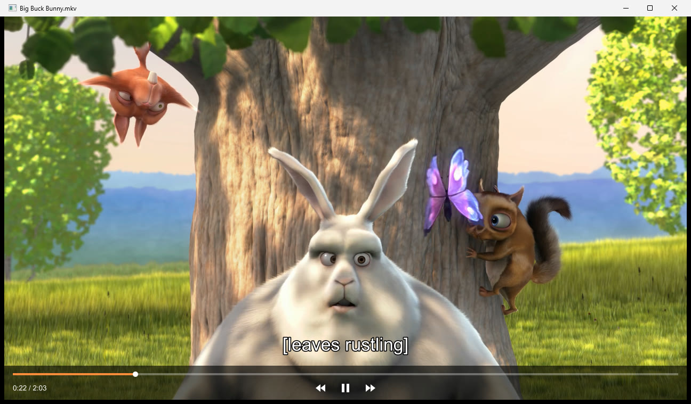
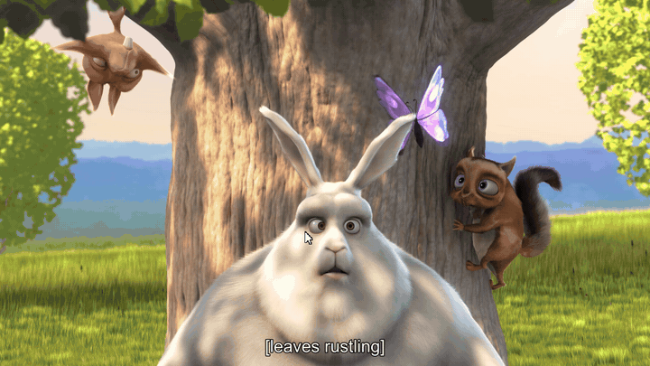
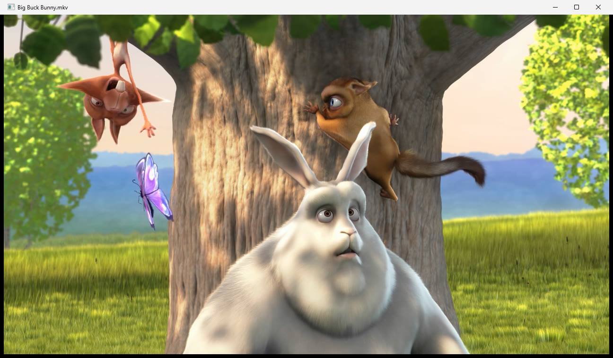
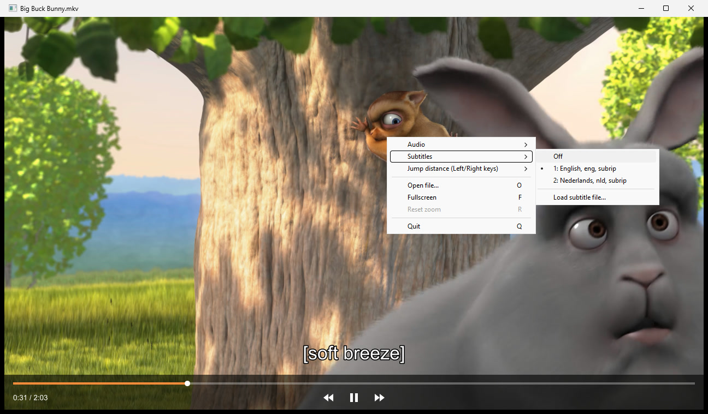
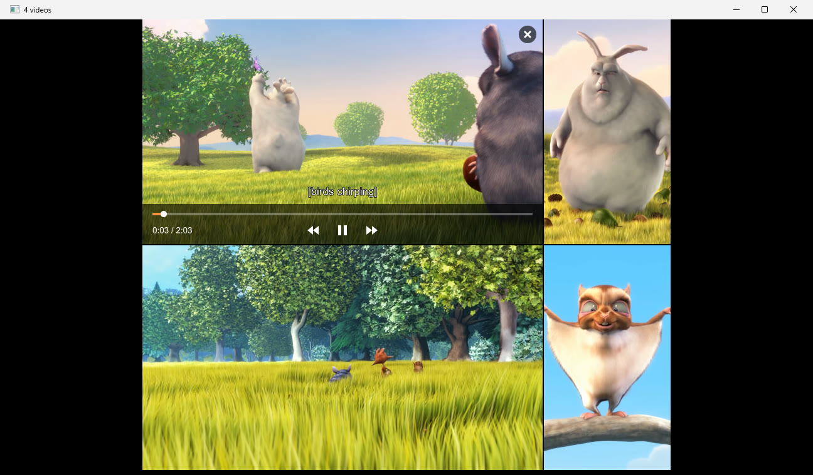

# MinimalVideoViewer

A tiny looping video player for Windows, built on libmpv (hardware decoding, GPU scaling).

**Scroll to zoom in at the mouse pointer.** The zoom stays put while the video keeps looping.

| VCR-style fast forward and rewind | Right-click menu: audio, subtitles and more |
| --- | --- |
|  |  |

**Play several videos at once.** The layout follows the shape of the videos, so wide and vertical
videos both get as much room as possible.

## Download

Get the zip from the [latest release](https://github.com/J-o-h-n-M/minimalvideoviewer/releases/latest),
unpack it and run `MinimalVideoViewer.exe`. Keep the exe and `libmpv-2.dll` together.
Needs 64-bit Windows 10 or 11 with up-to-date graphics drivers.

The exe is not code-signed, so Windows SmartScreen may warn the first time you run it:
click **More info** → **Run anyway**.

## Build

Run `build.bat` (needs Visual Studio C++ Build Tools). It downloads libmpv on first run and
produces `build\MinimalVideoViewer.exe` + `build\libmpv-2.dll` — keep those two files together.

## Use

`MinimalVideoViewer.exe video.mp4 [more.mp4 ...]`, drag files onto the window, or start it without
arguments to pick one or more files.
Videos always loop; zoom and pan are kept across loops. The window reopens with the size,
position and maximized state it had when you last closed it.

Moving the mouse shows a control bar (progress bar, rewind, play/pause, fast forward) that hides
after 5 seconds without mouse movement. Rewind and fast forward work like a VCR shuttle: smooth,
silent playback at 2x, and each extra press goes faster (4x, 8x, 16x). Rewind plays truly backwards
frame by frame and stops at the start; press play to return to normal playback.

### Several videos at once

Open several files at once, drag more onto the window, or press A, and they play side by side, up
to 16. The layout follows the shape of the videos so they are as large as possible: vertical videos
stand next to each other, wide ones are stacked. Each video loops and zooms on its own.

While you drag files over a video it shows two landing zones: **+ Add video** (left half, or top
half on a tall video) and **Replace this video** (the other half). The zone under the pointer lights
up. Subtitle files show a single **Load subtitles** zone.

The mouse and keys act on the video under the mouse pointer, which is also the only one you hear.
Hold Shift with Space, J/L, Left/Right or R to do it to all videos. Double-click a video to show only
that one; double-click again (or Esc) to go back to the grid. Hovering a video shows an X in its
top-right corner that removes it.

| Input | Action |
| --- | --- |
| Mouse wheel | Zoom in/out at the cursor |
| Left drag | Pan (when zoomed) |
| Click/drag progress bar | Seek |
| Right-click | Menu: audio track, subtitles (incl. loading a subtitle file), jump distance, add/replace/close video, fullscreen, reset zoom, quit |
| Drag videos onto "+ Add video" (or the black area) | Add them |
| Drag a video onto "Replace this video" | Replace that video (more files dragged at once are added) |
| Drag a subtitle file onto a video | Load and show it in that video (.srt, .ass, .ssa, .vtt, .sub, .idx, .sup) |
| X in the top-right corner (on hover) | Remove that video (when there are several) |
| R | Reset zoom |
| Double-click | Fullscreen (one video) / show only this video and back (several videos) |
| F / F11 | Fullscreen |
| Space / K | Play/pause (also ends rewind/fast forward) |
| J / L | Rewind / fast forward (press again: faster) |
| Left / Right | Jump back/forward (default 5 s; set it in the right-click menu, it is remembered) |
| Shift + Space, J/L, Left/Right, R | The same for all videos |
| Up / Down, M | Volume, mute (shown briefly at the top) |
| A | Add videos |
| O | Open a file in place of the video under the mouse |
| Delete | Close the video under the mouse (when there are several) |
| Esc | Leave fullscreen, or go back to the grid |
| Q | Quit |

## License

The code in this repository is MIT licensed (see [LICENSE](LICENSE)).

It uses [libmpv](https://mpv.io/), which is downloaded by `build.bat` and not part of this
repository. libmpv is licensed under the GPL, so if you distribute the built program together
with `libmpv-2.dll`, that bundle must follow the GPL terms (include the license text and make the
source available).

The preview images show *Big Buck Bunny*, (c) copyright 2008, Blender Foundation /
[www.bigbuckbunny.org](https://www.bigbuckbunny.org), licensed under
[CC BY 3.0](https://creativecommons.org/licenses/by/3.0/). The subtitles in the images were added
for the demo.
